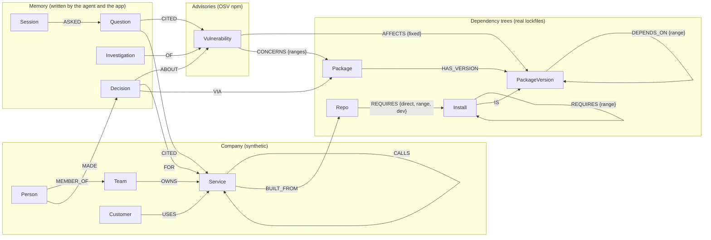

# Blast Radius

> Dependabot tells a repo it has a problem. Blast Radius tells the company what it means, the one fix that ends it, and remembers what you decided.

An agent that answers "a CVE dropped, what does it mean for us?" over a [FalkorDB](https://falkordb.com) graph of a company's services, their full dependency trees, known vulnerabilities, customers and past triage decisions.

Built for **Graph Hacks 2026** (WeMakeDevs × FalkorDB). Tracks: **01 Agents That Act on Connected Data** and **02 Agent Memory and Coordination**.

🚧 Work in progress. See [docs/plan.md](docs/plan.md) for the plan and [docs/decisions.md](docs/decisions.md) for every design decision and its reason.

## Quick start (local)

```bash
docker compose up -d          # FalkorDB on :6379, Browser on http://localhost:3000
uv sync                       # install dependencies
cp .env.example .env          # add your ANTHROPIC_API_KEY
uv run python -m blast_radius.ingest.load   # build the graph (~3 s, from the committed advisory snapshot)
uv run pytest                 # tests (need the graph loaded)
```

To refresh advisories from the full OSV npm dump (~220 MB): `./scripts/fetch_osv.sh && uv run python scripts/snapshot_osv.py`.

Then:

```bash
uv run uvicorn blast_radius.web:app      # web app on http://localhost:8000; streams every agent step and Cypher query live
                                         # (without an API key it runs a fixed pipeline over the same tools)
uv run python -m blast_radius.agent "Are we affected by CVE-2025-7783?"   # agent in the terminal
uv run python -m blast_radius.mcp_server # the graph tools as an MCP server (stdio), e.g. for Claude Desktop
```

Simulate a deploy and watch past decisions drift: in the web app, open **Decisions** and press **Deploy** (then **Roll back**). This swaps storefront's dependency tree in place, in under a second, and re-checks every decision. Scenarios are listed in `data/scenarios/scenarios.json`. From the command line, a full rebuild with the swapped lockfile does the same:

```bash
uv run python -m blast_radius.ingest.load --deploy storefront=data/scenarios/storefront-adds-koa-router.json.gz
```

The demo company's 14 services are real public repos at pinned versions (lockfiles committed in `data/lockfiles/`); teams, customers and service calls are synthetic (`data/company.json`).

## Deploy (FalkorDB Cloud + Render)

1. Create a free FalkorDB Cloud instance and note its host, port, username and password.
2. In Render, choose **New > Blueprint** and pick this repo. `render.yaml` defines one Docker web service.
3. Fill in `FALKORDB_HOST`, `FALKORDB_PORT`, `FALKORDB_USERNAME`, `FALKORDB_PASSWORD` (set `FALKORDB_SSL=true` if your instance requires TLS) and, optionally, `ANTHROPIC_API_KEY`.
4. On first start the container builds the graph in a few seconds from the committed data (`data/lockfiles`, `data/osv/npm-snapshot.zip`). An existing graph is left alone, so recorded decisions survive restarts.

Public-demo guards: agent runs are limited per IP per hour and per day (`AGENT_RUNS_PER_HOUR_PER_IP`, `AGENT_RUNS_PER_DAY`), after which runs fall back to the fixed pipeline. Idle sessions beyond `MAX_LIVE_SESSIONS` release their tool process. Leave `GITHUB_TOKEN` unset on a public deploy: the "Open issue" button then shows the draft instead of filing it.

Run the same container locally: `docker compose --profile app up --build`.

## Graph data model

Four layers in one FalkorDB graph: the **company** (synthetic), the **dependency trees** (real lockfiles), the **advisories** (OSV) and the **memory** the agent writes.



| Node | Key properties | What it is |
|---|---|---|
| `Team`, `Person`, `Customer` | `name`, `tier` (customers: enterprise / business / startup), `synthetic: true` | Who owns services and who depends on them |
| `Service` | `name`, `tier` (critical / standard / internal) | One of the 14 services of the demo company |
| `Repo` | `source`, `ref`, `url`, `lockfile`, `loaded_at` | The pinned public repo a service is built from, and which lockfile was loaded when (evidence, D-046) |
| `Install` | `key`, `repo`, `path` (`node_modules/...`), `name`, `version`, `dev` | One installed package at one path in one repo: the exact resolution, so chains are never mixed across repos (D-022) |
| `PackageVersion`, `Package` | `purl`, `name`, `version` | The merged, estate-wide package layer, used for PageRank chokepoints |
| `Vulnerability` | `id`, `aliases`, `summary` (full-text indexed), `severity`, `published` | An OSV advisory. `AFFECTS` edges are precomputed by evaluating its semver ranges against every installed version (D-005), and carry the fixed versions (D-023) |
| `Decision` | `id`, `verdict`, `reason`, `at`, `signatures`, `status` | A triage decision. `signatures` is the exact exposure (install path + chain) it was made against, which is how drift is detected (D-014, D-028) |
| `Investigation` | `vuln`, `at`, `signatures`, `lockfiles` | The last snapshot of an advisory's production exposure, for "what changed since the last look" (D-050) |
| `Session`, `Question` | `id`; `text`, `answer`, `tools`, `at` | Episodic memory of conversations and what each answer cited (D-029) |

Size of the demo graph after `ingest.load`: 20,122 `Install`, 7,643 `PackageVersion`, 4,455 `Package`, 1,125 `Vulnerability` nodes (532 affecting something installed); 40,236 `REQUIRES`, 22,255 `DEPENDS_ON`, 1,074 `AFFECTS` edges. It builds in about 3 seconds.

Indexes: `PackageVersion(purl)`, `Package(name)`, `Vulnerability(id)`, `Service(name)`, `Repo(name)`, `Customer(name)`, `Install(key)`, `Decision(id)`, `Session(id)`, `Investigation(vuln)`, plus a full-text index on `Vulnerability(summary, id)`.

## Queries and algorithms

Every query the product runs is a file in [queries/](queries/), and the web app streams each one (text, parameters, time, rows) as it runs.

**Graph algorithms**

| What | Where | How |
|---|---|---|
| Exposure paths (F1) | `exposure_paths.cypher` | `shortestPath((repo)-[:REQUIRES*]->(install))` from each service's repo to every install an advisory affects |
| Minimum upgrade cut (F3) | `max_flow_cut.cypher` + `analysis._min_cut` | `algo.maxFlow` on a scratch graph of one repo's exposure subgraph. Each edge's capacity is its effort (refresh lockfile 1, bump direct dependency 2, npm override 4, upstream release 6), expanded into unit-capacity parallel paths (D-024). The cut is read from the residual graph and translated into upgrade steps; an Edmonds–Karp fallback runs in Python if the algorithm times out |
| Estate-wide fix plan | `estate_affected_installs.cypher` + `analysis.estate_plan` | One min cut per service that separates it from every critical and high advisory at once, then identical changes grouped across services (D-042) |
| Chokepoints (F8) | `chokepoints.cypher` | `algo.pageRank` over the merged `PackageVersion`-`DEPENDS_ON` layer |
| Advisory search | `find_vulnerability.cypher` | `db.idx.fulltext.queryNodes` on advisory summaries; `vulnerability_by_id.cypher` for exact ids and CVE aliases |

**Queries**

| Query | Feature | Purpose |
|---|---|---|
| `exposure_paths` | F1 | Every exposed service, its team and tier, and the shortest chain to each affected install, with evidence (lockfile, load time, install path, affected ranges) |
| `safety_proof` | F4 | When nothing is exposed: every installed version of the concerned packages, next to the affected ranges |
| `customer_impact` | F2 | Customers who use an exposed service directly or through up to 3 `CALLS` hops |
| `affected_installs`, `repo_requires_subgraph` | F3 | Input to the upgrade cut: affected installs per repo and the repo's install graph |
| `package_advisories` | F3 | Every advisory on the packages a plan touches, to check that a fix version is not itself affected (D-048) |
| `risk_board` | | Advisories reaching production ranked by severity × tier-weighted customers reached, untriaged first, with the factors behind each score (D-041, D-049) |
| `record_decision` | F5 | Writes a `Decision` with its exposure signatures and `VIA` edges to the packages on its chains |
| `recall_precedent`, `path_precedent` | F5 | Past decisions on the same advisory, the same package, or another advisory reached through the same dependency chain (D-039) |
| `current_decisions`, `exposure_signatures` | F6 | Every decision and today's exposure, compared to mark decisions stale (drift) |
| `advisory_signatures`, `save_investigation`, `investigations` | F6 | What changed since the last investigation of an advisory (D-050) |
| `log_turn`, `session_history` | Memory | Episodic memory of questions, answers and cited nodes, kept across rebuilds (D-044) |
| `repo_lockfiles` | F6 | Which lockfile each service runs, for simulated deploys (D-038) |
| `graph_stats`, `top_advisories` | | Node counts for the header; advisories by number of services (handy in FalkorDB Browser) |

## AI assistance disclosure

This project is built with help from Claude (Anthropic) as a coding assistant. Design decisions and their reasons are recorded in [docs/decisions.md](docs/decisions.md).
